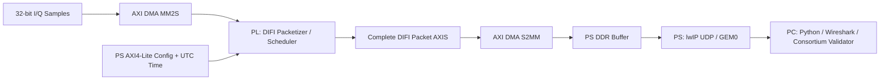

# DIFI 1.1 FPGA Digital IF Protocol Engine

> 面向 AMD Zynq-7000 SoC 的可配置 Digital IF 协议收发引擎：从 32-bit I/Q 样本到 DIFI Packet，再到真实 UDP 网络传输与独立协议验证。
>
> **项目状态（2026-10-23）：** RTL 功能仿真、Zynq-7020 封装 IP 板级回环、B5 FPGA→PC UDP TX，以及 B6 PC→FPGA UDP RX 三类报文联测均有归档证据。B6 Version/Context 以 PL Metadata 握手、序列号和错误事件监测为依据，Data 通过 DMA 恢复 IQ 并进行 Golden 比对。DIFI Consortium 开源参考工具 PASS 仅针对 B5 流量，不等于正式认证或整个 DIFI 1.1 规范覆盖。

[架构与功能](#1-项目概述) · [实测结果](#2-验证状态与实测结果) · [快速复现](#5-快速复现) · [文件索引](#7-仓库目录与提交物对照) · [限制与待办](#8-已知限制与后续工作)

**Windows 桌面演示台：** [DIFI ENGINE CONTROL CENTER](dashboard/README.md) 使用 PySide6 + pyqtgraph 集成现有 B5/B6 校验工具，提供链路动画、逐包统计、IQ 波形、日志与会话导出；默认 Replay / Offline，无开发板也可演示。安装 `dashboard/requirements.txt` 后运行 `python dashboard/main.py`，硬件模式仅在点击 Run 后通信。

## 1. 项目概述

### 1.1 背景与目标

DIFI（Digital Intermediate Frequency Interoperability）基于 VITA 49.x 数据流格式，面向数字中频（Digital IF）设备之间的标准化数据交换。本项目实现 **DIFI 1.1 的受限 Profile**，将采样数据的协议封装、解封装、上下文信息和版本信息处理放在 FPGA 可编程逻辑（PL）侧，并通过 Zynq 处理系统（PS）与 PC 完成以太网验证。

项目目标是构建**可复用、可配置、可验证的 RTL 协议 IP**，而不是只在 PS 上用软件拼接 DIFI 字节流。UDP/IP/Ethernet 的封装和网络栈由 PS 侧 lwIP 承担，不属于 DIFI RTL 核心。

### 1.2 当前实现范围

| 组成 | 已实现的功能 | 对应源码 |
| --- | --- | --- |
| Signal Data TX / RX | IQ 样本封装为 Data Packet、接收解析并恢复 IQ；接收侧检查报文结构、长度、`TKEEP/TLAST` 和 Stream ID 等 | [`rtl/data/`](rtl/data/) |
| Context TX / RX | Context 生成、接收及元数据输出；采样率、带宽、RF 频率、Payload Format 等 | [`rtl/context/`](rtl/context/) |
| Version TX / RX | Version Flow Signal Context 报文生成、解析及元数据输出 | [`rtl/version/`](rtl/version/) |
| 调度与分流 | 三种 TX 报文的包级调度；RX 按类型分流 | [`rtl/tx/`](rtl/tx/)、[`rtl/rx/`](rtl/rx/) |
| 配置与时间 | AXI4-Lite 寄存器、配置 Commit、时间初始化/递增与周期触发 | [`rtl/common/`](rtl/common/)、[`rtl/include/`](rtl/include/) |
| 封装 IP | `difi_engine_ip`，对外提供 AXI4-Stream IQ/Packet、AXI4-Lite 配置/时间接口 | [`rtl/top/difi_engine_ip.v`](rtl/top/difi_engine_ip.v)、[`ip_repo/difi_engine_ip/`](ip_repo/difi_engine_ip/) |
| 板级 UDP TX（B5） | PL 生成完整 DIFI Packet，DMA 回传 DDR，由 PS/lwIP/GEM0 经 UDP 发到 PC | [`vitis/vitis_ws/difi_b5_udp_tx/src/`](vitis/vitis_ws/difi_b5_udp_tx/src/) |
| 板级 UDP RX（B6 v0.2） | PC UDP→PS DDR→DMA MM2S→PL RX；Version/Context 监测 Metadata 握手，Data DMA 恢复 IQ 并由 PS 校验 | [`vitis/vitis_ws/difi_b6_udp_rx_pro/src/`](vitis/vitis_ws/difi_b6_udp_rx_pro/src/)、[`rtl/board/difi_b6_rx_meta_monitor.v`](rtl/board/difi_b6_rx_meta_monitor.v) |

**当前 Profile 的主要边界：** Data Payload 为复数笛卡尔格式 **I16/Q16**（每个 IQ 样本 32 bit）；应用示例为每包 256 个 IQ 样本；Data Packet 含 7 个 32-bit 协议头 Word，Context 固定 27 Word，Version 固定 11 Word。项目没有实现全部 VITA 49.2/DIFI 可选 Packet 类型或任意格式的 IQ 数据；请勿按“完整 DIFI 规范实现”理解。

### 1.3 数据流与软硬件划分



以上是 **B5 UDP 导出路径**，只验证发送完整报文。协议 IP 还另有 RX 解析路径：

```text
32-bit IQ -> DIFI TX -> DIFI Packet -> DIFI RX -> 32-bit IQ + Metadata
```

此完整 TX→RX 路径在 RTL 与**封装 IP 回环工程**中验证；B5 原始 Packet 导出工程则绕过 RX Parser，直接把 TX Packet 交给 DMA。另有独立 **B6 UDP RX** 硬件工程：PC UDP→PS/lwIP→DMA MM2S→PL `S_AXIS_RX_PKT`，Data 由 PL `M_AXIS_IQ`→DMA S2MM 返回 PS，Context/Version 由 Metadata Monitor 经 AXI GPIO 供 PS 观测。**三套硬件的 XSA/ELF 不可互换，B5 与 B6 是不同配置下分别完成的两向验证，不等于同时全双工。**

## 2. 验证状态与实测结果

以下数字均对应指定测试条件；不同统计口径不能直接视为同一硬件链路的吞吐率。

| 验证项目 | 已取得的结果 | 条件或说明 | 证据 |
| --- | --- | --- | --- |
| RTL 连续 Data 回环 | **100/100 包，25,600/25,600 IQ，错误事件 0** | 100 MHz、每包 256 IQ、无外部背压 | [`sim/perf/tb_difi_engine_perf.v`](sim/perf/tb_difi_engine_perf.v) |
| RTL 有效 IQ 吞吐率 | **196.916 MB/s** | 52,002 个 100 MHz 时钟周期；有效 IQ 字节数除以测试窗口 | [`report/results/perf/difi_perf_latency.csv`](report/results/perf/difi_perf_latency.csv) |
| RTL 首 IQ 延迟 | **266 / 516.470 / 519 cycles** | 最小 / 平均 / 最大；从输入首 IQ 握手到输出首 IQ 握手 | [`report/results/perf/performance_summary.md`](report/results/perf/performance_summary.md) |
| 封装 IP 板级回环 | **100 包、25,600 IQ，失配 0** | Zynq-7020，AXI DMA Simple Mode，逐包提交 | [`report/results/perf/board_IP_perf.rtf`](report/results/perf/board_IP_perf.rtf) |
| 板级完整测试窗口有效吞吐率 | **约 25.01 MB/s** | PS/DDR/DMA/缓存与软件校验在内；Cortex-A9 PMU 计时，CPU 666.667 MHz | 同上 |
| 板级 DMA 事务窗口有效吞吐率 | **约 107.18 MB/s** | 100 次 DMA 提交至完成计时窗口之和；**仍非纯 PL/IP 吞吐率** | 同上 |
| 封装 IP 资源 | **1,776 LUT / 2,309 FF / 1 RAMB18 / 0 DSP** | 包含协议核心、时间源及封装外层功能 | [`utilization.rpt`](report/results/packaged_ip_impl/utilization.rpt) |
| 100 MHz 时序 | **WNS +0.411 ns，TNS 0** | XC7Z020CLG400-2，Vivado 2024.2，布局布线后满足时序 | [`timing_summary.rpt`](report/results/packaged_ip_impl/timing_summary.rpt) |
| B5 UDP TX：FPGA→PC | **22/22 Packet；5,120/5,120 IQ 正确** | Version×1、Context×1、Data×20；UDP Payload 合计 21,192 B | [`TX 原始记录`](report/results/udp/tx/validation_notes.md) |
| B6 UDP RX：PC→FPGA | **Version×1、Context×1、Data×20，5,120 IQ 匹配** | 原始工程三类报文 UART PASS；新 XSA 板级回归由开发者确认 PASS，本阶段完成 | [`B6 v0.2 串口记录`](report/results/udp/rx/three_types_udp_rx.rtf) |
| B6 从真实 BD Tcl 独立重建 | **综合、实现、Bitstream/XSA PASS；WNS +2.372 ns、WHS +0.053 ns** | Vivado 2024.2；工具原始 SUCCESS 与独立实现报告已入库 | [`重建工具报告`](report/results/vivado_rebuild/b6_udp_rx/SUCCESS.txt) |
| 第三方 DIFI 1.1 参考校验 | **Version 1/1、Context 1/1、Data 20/20，均 PASS** | Version 与 Context/Data 两条 Stream ID 分别校验 | [`report/results/udp/tx/consortium/`](report/results/udp/tx/consortium/) |

**吞吐率校准说明：** 板级 PMU 实测完整测试窗口为 2,729,306 CPU cycles，100 次 DMA 事务窗口累计 636,916 CPU cycles；PS CPU 工作频率确认为 **666.666666 MHz**（表内约 666.667 MHz）。据此计算得约 **25.01 MB/s** 和 **107.18 MB/s**。这是短时软件驱动回环测试，不能作为 DIFI RTL 的板级峰值吞吐率，亦不等同于网络线速。`report/results/perf/performance_summary.md` 已同步记录上述换算；PS CPU 时钟 **666.666666 MHz（已确认）**，原有表格中 666.667 MHz 仅为三位小数显示。与此次实际测试版本的 XSA/时钟设置对应关系仍应留存证据，但不是“频率待确认”。

**UDP 结果说明：** 当前 UDP Demo 每包人为间隔约 **2 ms**，只用于正确性验证，不以接收耗时推导 UDP 最大吞吐率。Consortium 开源工具的 PASS 是指定报文及约束的**独立参考检查结果**，**不是 DIFI Consortium 正式认证**。

### 2.1 FPGA 资源口径

| 层级 | LUT | FF | RAMB36 | RAMB18 | DSP |
| --- | ---: | ---: | ---: | ---: | ---: |
| 仅协议核心 `u_engine` | 1,389 | 1,773 | 0 | 1 | 0 |
| 可封装 IP `difi_engine_ip_0` | 1,776 | 2,309 | 0 | 1 | 0 |
| 完整 PL 系统 `difi_ip_test_wrapper` | 4,562 | 6,000 | 2 | 1 | 0 |

完整 PL 统计包含 AXI DMA、互连和复位等外围模块；不要把总系统消耗写成“DIFI 核心资源”。

## 3. RTL 结构与接口

### 3.1 主要模块

```text
rtl/
├── top/
│   ├── difi_engine_top.v        # 核心结构顶层：TX + RX + AXI-Lite
│   └── difi_engine_ip.v         # 可封装 IP：核心 + 时间源/周期触发
├── data/                        # Data Packetizer / Parser
├── context/                     # Context Generator / Parser
├── version/                     # Version Generator / Parser
├── tx/                          # Packet TX Scheduler
├── rx/                          # RX Packet Dispatcher
├── common/                      # Config registers, time registers/source, triggers
├── include/                     # DIFI definitions + AXI-Lite register maps
└── board/                       # 分阶段 Zynq 板级封装（含 B4/B5）
```

### 3.2 外部接口约定

- **单时钟域**：`aclk`，低有效 `aresetn`；实测 PL 目标时钟 100 MHz。
- **AXI4-Stream（32 bit）**：输入 IQ `S_AXIS_IQ`，输出完整 Packet `M_AXIS_TX_PKT`，输入 Packet `S_AXIS_RX_PKT`，输出恢复的 IQ `M_AXIS_IQ`。采用 `TVALID && TREADY` 握手；Packet 通道包含 `TKEEP/TLAST`。
- **IQ 边界**：Packetizer 按配置的 `samples_per_packet` 计数，不依赖上游 IQ `TLAST` 判定报文终止。封装 IP 虽接受上游 `TKEEP/TLAST` 端口，该两个输入不参与 Packetizer 的样本计数。
- **元数据**：Data、Context、Version 接收结果各有 `VALID/READY` 接口；未使用时也必须正确处理 READY，避免接收通路被阻塞。
- **AXI4-Lite**：`S_AXI_CTRL` 为配置/状态寄存器，`S_AXI_TIME` 为独立时间初始化寄存器。TX 的 Shadow 配置在 Commit 后生效；RX Stream ID 过滤可配置。
- **时间戳**：秒（32 bit）与秒内皮秒（64 bit）组合；本次 UDP Demo 由 UART 输入 UTC 初值并由 PL 时间源推进，不代表已经与外部 PTP/GPS 时钟完成同步。

寄存器的唯一权威定义见 [`rtl/include/difi_cfg_regmap.vh`](rtl/include/difi_cfg_regmap.vh) 与 [`rtl/include/difi_time_cfg_regmap.vh`](rtl/include/difi_time_cfg_regmap.vh)；完整端口和状态约定参见 [`docs/interface/`](docs/interface/) 中的接口规格文档。

常用寄存器偏移（相对于各自 AXI4-Lite 基址）：

| `S_AXI_CTRL` | 偏移 | `S_AXI_TIME` | 偏移 |
| --- | --- | --- | --- |
| CONTROL（TX Enable） | `0x00` | UTC Seconds | `0x00` |
| COMMAND（Commit） | `0x04` | Fractional picoseconds low | `0x04` |
| STATUS | `0x08` | Fractional picoseconds high | `0x08` |
| Data Stream ID | `0x10` | COMMAND（Time Load） | `0x0C` |
| Version Stream ID | `0x14` | STATUS | `0x10` |
| Samples/Packet | `0x18` | | |
| Context/Version Period | `0x2C` / `0x30` | | |

## 4. 开发环境

| 类别 | 已验证或使用的环境 |
| --- | --- |
| 开发板 | 正点原子领航者 ZYNQ-7020（XC7Z020CLG400-2） |
| FPGA/SoC 开发 | **Vivado / Vitis 2024.2** |
| PS 软件 | Cortex-A9 Standalone，Vitis 2024.2 SDT Platform；联网工程使用 `lwip220` RAW API（`NO_SYS=1`） |
| RTL | Verilog-2001；Icarus Verilog `-g2005` 测试 |
| 上位机 | Windows、Python 3、Wireshark、DIFI Consortium `DIFI-Certification` |
| 板级网口示例 | PS GEM0；板端 `192.168.1.10`，PC 端 `192.168.1.20`，UDP `4991`，掩码 `/24` |

**版本兼容声明：** AMD 2026 FPGA 创新设计赛道自主选题指南推荐 Vivado/Vitis 2026.1 或 2025.2；本工程实测采用 **2024.2**。跨版本复现需要重新核对 IP 版本、SDT BSP、lwIP、XSA 和时钟/地址映射，本仓库没有声称已在 2025.2/2026.1 上完成回归。

## 5. 快速复现

### 5.1 获取源码与确认分支

```powershell
git clone https://github.com/tutushiyigeop-oss/difi-engine.git
cd difi-engine
git switch feature/rtl-integration
```

以下相对路径均以仓库根目录为起点。

### 5.2 RTL 仿真：连续 Data TX→RX 回环

安装 `iverilog` / `vvp`，并将其加入 `PATH`。在 **PowerShell** 中执行：

```powershell
New-Item -ItemType Directory -Force sim/icarus | Out-Null

$src = @(
  'rtl/common/difi_cfg_regs.v',
  'rtl/data/difi_data_packetizer.v',
  'rtl/data/difi_data_parser.v',
  'rtl/context/difi_context_generator.v',
  'rtl/context/difi_context_parser.v',
  'rtl/version/difi_version_generator.v',
  'rtl/version/difi_version_parser.v',
  'rtl/tx/difi_tx_scheduler.v',
  'rtl/rx/difi_rx_dispatch.v',
  'rtl/top/difi_engine_top.v',
  'sim/perf/tb_difi_engine_perf.v'
)

iverilog -g2005 -I rtl/include -s tb_difi_engine_perf `
  -o sim/icarus/tb_difi_engine_perf.vvp $src
vvp sim/icarus/tb_difi_engine_perf.vvp +packets=100
```

预期以 `[PASS] tb_difi_engine_perf` 结束，延迟明细输出到 `sim/perf/difi_perf_latency.csv`。重新运行会覆盖此 CSV；**若只需复核历史结果，优先阅读 `report/results/perf/` 中已经归档的证据**。此仿真不包括 PS、DMA、UDP、物理网络或实际 DDR 访问。

### 5.3 Vivado：区分封装 IP、B5 与 B6 三类硬件设计

| 目的 | RTL/BD 选择 | DMA S2MM 最终收到的内容 | 对应 Vitis App |
| --- | --- | --- | --- |
| 封装 IP 收发回环与性能 | 封装 IP `ip_repo/difi_engine_ip/`，BD `difi_ip_test`（已实现报告顶层：`difi_ip_test_wrapper`） | **解封装 IQ 数据** | [`difi_ip_loopback_test`](vitis/vitis_ws/difi_ip_loopback_test/src/)、[`difi_ip_perf_test`](vitis/vitis_ws/difi_ip_perf_test/src/) |
| B5 原始 Packet / UDP 导出 | [`rtl/board/difi_engine_board_b5.v`](rtl/board/difi_engine_board_b5.v)，模块 `difi_board_raw_packet_export` | **DIFI 完整 Packet（头部+IQ）** | [`difi_stage_b5-b_test`](vitis/vitis_ws/difi_stage_b5-b_test/src/)、[`difi_b5_udp_tx`](vitis/vitis_ws/difi_b5_udp_tx/src/) |
| B6 PC→UDP→PL RX | DMA MM2S 接 DIFI `S_AXIS_RX_PKT`；DIFI `M_AXIS_IQ` 接 DMA S2MM；Metadata Monitor→双通道 AXI GPIO | **Data 恢复的 IQ**；Context/Version 不输出 IQ | [`difi_b6_udp_rx_pro`](vitis/vitis_ws/difi_b6_udp_rx_pro/src/) |

**不要混用三种 XSA / Vitis 应用。** 封装 IP 回环输出 IQ；B5 DMA S2MM 得到完整 DIFI Packet；B6 MM2S 输入完整 Packet、Data 的 S2MM 输出 IQ，Context/Version 通过 Metadata 监测。B6 的 PS Ethernet/MDIO 使用 B5 已联网成功的 MIO 配置（MDIO MIO 52/53），历史 `packaged_ip` 快照不代表 B6 的以太网配置。

**三套板级设计已经完成独立重建与开发者确认的功能回归：** [`packaged_ip`](scripts/vivado/generated/packaged_ip/)、[`b5_raw_export`](scripts/vivado/generated/b5_raw_export/) 和 [`b6_udp_rx`](scripts/vivado/generated/b6_udp_rx/)。仓库已保存真实 BD Tcl/manifest、IP/RTL 依赖、自动重建脚本和各自综合、实现、时序及 Bitstream/XSA 工具 PASS 记录。**B6 v0.2 于 2026-10-23 完成独立新工程重建和 Version/Context/Data 三类 UDP RX 板级回归，本阶段验收结束。** 本地生成的 .xpr、.bit、.xsa 不作为仓库提交物；可通过 Vivado 2024.2 按 [重建指南](scripts/vivado/README.md) 再生。B6 的 XSA/Bitstream SHA256 与开发者确认的回归结论见 [B6 阶段验收记录](report/results/vivado_rebuild/b6_udp_rx/BOARD_REGRESSION_STATUS.md)。**功能回归来自开发者实测确认；本项目未声称已由独立第三方在陌生机器复现。**

```powershell
# 在仓库根目录、Vivado 2024.2 命令行环境中分别运行
vivado -mode batch -source scripts/vivado/rebuild_bd.tcl -tclargs packaged_ip
vivado -mode batch -source scripts/vivado/rebuild_bd.tcl -tclargs b5_raw_export
vivado -mode batch -source scripts/vivado/rebuild_bd.tcl -tclargs b6_udp_rx
# 在每套新工程独立重建成功后运行对应实现；脚本会保护已有 SUCCESS.txt
vivado -mode batch -source scripts/vivado/verify_rebuilt_impl.tcl -tclargs packaged_ip
vivado -mode batch -source scripts/vivado/verify_rebuilt_impl.tcl -tclargs b5_raw_export
vivado -mode batch -source scripts/vivado/verify_rebuilt_impl.tcl -tclargs b6_udp_rx
```

上述命令是**重新复现时的操作说明**，不是要求对现有已完成工程重复执行；重建目标目录已存在时必须先手动核对并另行处理。原始 BD 的 AXI 连接和 PS/PL 设置还应核对以下项目：

1. `processing_system7_0` 的 FCLK 设为 **100 MHz**；启用 AXI GP/HP 数据通路、DDR 和 B5 UDP 所需的 **PS GEM0** 及对应 PHY/MIO 配置。
2. AXI DMA 使用 **Simple Mode（非 Scatter-Gather）**，MM2S、S2MM 数据流宽度为 32 bit，PS 侧 DDR 通过 AXI 通路访问；S2MM 接收端须支持逐包 `TLAST`。
3. AXI-Lite 映射 `S_AXI_CTRL`、`S_AXI_TIME`；当前测试软件默认控制基址 `0x40000000`、时间基址 `0x40001000`，DMA 基址由 SDT `xparameters.h` 获取。**必须与 Vivado Address Editor / XSA 核对**，不要盲用示例地址。
4. B5 的 `S_AXIS_IQ` 连接 DMA MM2S，`M_AXIS_PKT` 连接 DMA S2MM；先启动 S2MM 接收再触发 TX，以保留启动 Version/Context 报文。
5. 生成 bitstream 与含 bitstream 的 XSA，在 Vitis 2024.2 中创建 `ps7_cortexa9_0` Standalone Platform；UDP 工程需启用 `lwip220`（RAW API，`NO_SYS=1`）。

编译后已布线硬件的资源和时序，可在 Vivado Tcl Console 执行：

```tcl
open_run impl_1
report_utilization -hierarchical -file utilization_hierarchical.rpt
report_timing_summary -file timing_summary.rpt
```

### 5.4 Zynq 板级回环与性能测试

基于**封装 IP 回环 XSA**，在 Vitis Platform 上创建 Standalone Application，将相应 `src/` 中的 C/H 文件放入应用后构建、下载 bitstream、运行 ELF：

- 功能回环入口：[`vitis/vitis_ws/difi_ip_loopback_test/src/difi_ip_loopback_test.c`](vitis/vitis_ws/difi_ip_loopback_test/src/difi_ip_loopback_test.c)。
- 板级性能入口：[`vitis/vitis_ws/difi_ip_perf_test/src/difi_ip_perf_test.c`](vitis/vitis_ws/difi_ip_perf_test/src/difi_ip_perf_test.c)。

性能测试使用 2 包预热 + 100 包正式测试；Cortex-A9 PMU 硬件计数器已在该板级环境中作为计时来源，CPU 实际约 666.667 MHz。注意 Vitis 2024.2 SDT 环境中 `xtime_l.h` 与旧式 `XPAR_CPU_*` 时钟宏的兼容性问题；仓库中的 `difi_perf_timer.h` 已提供计时源自检/备用方案。正式比较软件处理效率时应记录 Debug `-O0` 或 Release `-O2` 配置。

### 5.5 Zynq B5 → PC：22 包 UDP 联调

**硬件前提：使用 B5 原始 Packet 导出 XSA，不能使用封装 IP 回环 XSA。** 在 Vitis 2024.2 Standalone + `lwip220` 的 Platform 中，以 [`difi_b5_udp_tx.c`](vitis/vitis_ws/difi_b5_udp_tx/src/difi_b5_udp_tx.c) 新建应用并运行：

1. 将 Zynq PS GEM0 网口接入与 PC 有线网卡互通的网络；示例配置：开发板 `192.168.1.10/24`，PC `192.168.1.20/24`，UDP 端口 `4991`。确保本机防火墙允许该 UDP 端口。
2. 重新下载 B5 bitstream（保证 PL 时间状态复位），再运行 ELF。
3. 串口出现 `[WAIT_UTC]` 时输入 `UTC <UNIX_SECONDS> <NANOSECONDS>`，例如 `UTC 1761000000 0`（仅示例；若需正确绝对时间戳，应使用实际 UTC 秒值）。
4. 待串口提示 `[WAIT]` 等待 `START`，在 PC 的仓库根目录运行：

   ```powershell
   python scripts/verify/tools/difi_udp_receiver.py `
     --board 192.168.1.10 --pc-ip 192.168.1.20 `
     --output report/results/udp/tx/difi_udp_capture.bin
   ```

5. PC 发出 `START` 后，Zynq 会把目标 IP/端口设置为**该 UDP 命令的来源**，依次传输 Version×1、Context×1、Data×20。`DATA_SID=1`、`VERSION_SID=2`，Data Sequence Number 为 `0..15,0..3`。预期 PC 端输出 `[PASS] DIFI UDP full chain`，合计 **5,120 个 IQ 样本正确**。

串口/接收端所采用的测试用 IQ 为确定性模式，不代表接入实际 ADC 或射频前端。`difi_udp_receiver.py` 输出的是长度前缀的原始 UDP Payload 拼接文件 **`.bin`**，**不是 `.pcap` / `.pcapng`**；真实网络包须由 Wireshark 单独抓取。

### 5.6 Zynq B6：PC UDP→PL RX 三类报文验收

**硬件前提：使用增加了 Metadata Monitor + 双通道 AXI GPIO 的 B6 v0.2 XSA/Bitstream，运行 [`difi_b6_udp_rx_pro`](vitis/vitis_ws/difi_b6_udp_rx_pro/src/main.c)（不是 B6 v0.1 Data-only ELF）。** 端口 `4991`，板端 `192.168.1.10`，PC `192.168.1.20`。PC 命令：

```powershell
python scripts/verify/tools/difi_b6_three_types.py --board 192.168.1.10 --local-ip 192.168.1.20 --types version,context,data --rounds 20
```

已归档 [B6 v0.2 板级串口记录](report/results/udp/rx/three_types_udp_rx.rtf)：Version 44 B×1 与 Context 108 B×1 由 PL Metadata Monitor 观测到有效握手各 1 次，检查 Sequence、Changed 与相关错误事件；Data 1052 B×20 经 PL Parser 恢复 20×256 IQ 样本，PS Golden 比对均正确，Sequence 覆盖 15→0。B6 v0.1 的 Data-only 历史日志另见 [`data_udp_rx.rtf`](report/results/udp/rx/data_udp_rx.rtf)，勿与 v0.2 混淆。**当前 Metadata 监测未逐字段将全部 Context/Version 值回读至 PS；未完成持续无 ACK 流的吞吐、丢包或同时双向运行验证。**

[PC 三类发包器](scripts/verify/tools/difi_b6_three_types.py)依赖同目录 [Data 报文生成器](scripts/verify/tools/difi_b6_sender.py)；[B6 复现说明](scripts/vivado/B6_REPRODUCTION.md)与[阶段验收记录](report/results/vivado_rebuild/b6_udp_rx/BOARD_REGRESSION_STATUS.md)给出独立重建、工具结果、文件指纹与开发者确认的板级 PASS，本阶段已经收束。

### 5.7 Wireshark 与 DIFI Consortium 参考验证

**Wireshark**：在 PC 连接板卡的有线网卡抓包，显示过滤器：

```text
ip.src == 192.168.1.10 && ip.dst == 192.168.1.20 && udp.dstport == 4991
```

预期为 1 个 44 B、1 个 108 B、20 个 1052 B **UDP Payload**。保存完整抓包为 [`report/results/udp/tx/difi_b5_udp_22.pcapng`](report/results/udp/tx/difi_b5_udp_22.pcapng)，解析界面截图见 [`report/results/udp/tx/screenshots/`](report/results/udp/tx/screenshots/)。Wireshark 内置 VITA 49 解析器有时优先占用协议识别，显示 `VITA 49` 并不等于协议校验失败。

**独立验证**：DIFI Consortium 开源仓库：[DIFI-Certification](https://github.com/DIFI-Consortium/DIFI-Certification)。根据其安装说明设置 Python 环境，并运行 `certify_source.py`；**必须显式指定 `--difi-version 1.1`**（官方脚本默认版本可能不是 1.1）：

```powershell
# 在 DIFI-Certification 仓库根目录执行；把下列路径替换为你自己的绝对路径
.\.venv\Scripts\python.exe .\certify_source.py `
  --pcap "<DIFI_REPO>\report\results\udp\difi_b5_udp_version_only.pcapng" `
  --difi-version 1.1

.\.venv\Scripts\python.exe .\certify_source.py `
  --pcap "<DIFI_REPO>\report\results\udp\difi_b5_udp_context_data.pcapng" `
  --difi-version 1.1
```

本项目 Version 使用 Stream ID 2，而 Context/Data 使用 Stream ID 1。所用版本的官方参考脚本会跨报文复用一个 Stream ID 状态，因此**按流分开校验**以避免混流检查的误报。已归档结果：Version **1/1 PASS**，Context **1/1 PASS**，Data **20/20 PASS**；原始 `console.txt`、`error_log.txt`、`result.txt` 和 YAML 位于 [`report/results/udp/tx/consortium/`](report/results/udp/tx/consortium/)。这不是官方认证证书。

## 6. 可复核的工程证据

| 内容 | 位置 |
| --- | --- |
| RTL 性能 Testbench | [`sim/perf/tb_difi_engine_perf.v`](sim/perf/tb_difi_engine_perf.v) |
| RTL 逐包延迟 CSV | [`report/results/perf/difi_perf_latency.csv`](report/results/perf/difi_perf_latency.csv) |
| Zynq 板级 PMU/回环串口日志 | [`report/results/perf/board_IP_perf.rtf`](report/results/perf/board_IP_perf.rtf) |
| 封装 IP 利用率与时序、关键路径、DRC | [`report/results/packaged_ip_impl/`](report/results/packaged_ip_impl/) |
| B4/B5 板级实现报告 | [`report/results/b4_impl/`](report/results/b4_impl/)、[`report/results/b5_impl/`](report/results/b5_impl/) |
| 完整 UDP 网络抓包 | [`report/results/udp/tx/difi_b5_udp_22.pcapng`](report/results/udp/tx/difi_b5_udp_22.pcapng) |
| 分流后的第三方验证输入 | [`report/results/udp/tx/difi_b5_udp_version_only.pcapng`](report/results/udp/tx/difi_b5_udp_version_only.pcapng)、[`difi_b5_udp_context_data.pcapng`](report/results/udp/tx/difi_b5_udp_context_data.pcapng) |
| 参考工具校验输出与截图 | [`report/results/udp/tx/consortium/`](report/results/udp/tx/consortium/)、[`report/results/udp/tx/screenshots/`](report/results/udp/tx/screenshots/) |
| UDP 验证文字记录 | [`report/results/udp/tx/validation_notes.md`](report/results/udp/tx/validation_notes.md) |
| 历史分阶段的工具/验证归档 | [`verification/`](verification/) |

## 7. 仓库目录与提交物对照

```text
difi-engine/
├── rtl/                  # 可综合 Verilog，协议核心、封装和板级 Shell
├── ip_repo/              # Vivado 自定义 DIFI IP 包
├── sim/                  # 模块与系统 Testbench、仿真向量、性能测试
├── vitis/vitis_ws/       # 各阶段应用的 src/*.c / *.h（生成工作区被忽略）
├── scripts/              # RTL/Vivado Tcl、Python 验证、绘图与审查脚本
├── verification/         # 旧阶段的 PCAP、标准校验与记录
├── report/results/       # RTL、封装 IP、B4/B5 与 B6 TX/RX UDP 证据
├── report/competition/   # 设计报告初稿、AI 协作复盘、量化证据索引（尚待终验）
├── docs/                 # 接口规格及开发备注
├── board/                # 板级目录（部分为预留）
├── host/                 # PC 工具预留目录
└── skill/                # 四个可复用 Skill 已制作；统一真实/跨项目验收待完成
```

这套目录与 AMD 自主选题赛道推荐的 `src/`、`sim/`、`build/`、`board/`、`data/`、`skill/`、`report/` **不是一一同名**，对应关系如下：

| 官方推荐类型 | 本仓库位置 |
| --- | --- |
| 源码 `src/` | `rtl/`、`vitis/vitis_ws/*/src/`、`ip_repo/` |
| 仿真与验证 `sim/` | `sim/`、`scripts/verify/`、`verification/` |
| 构建文件与实现报告 `build/` | `scripts/vivado/{export_bd,rebuild_bd,verify_rebuilt_impl}.tcl`、`scripts/vivado/generated/`、`ip_repo/`、`report/results/vivado_rebuild/` |
| 上板工程与证据 `board/` | `rtl/board/`、`vitis/vitis_ws/`、`report/results/` |
| 测试数据 `data/` | `sim/vectors/`、`report/results/perf/`、`report/results/udp/` |
| 技能包 `skill/` | `skill/` 下四套 Skill，均已制作；新通用工具的真实/跨项目验收待统一进行 |
| 设计报告 `report/` | `report/competition/` 现有初稿、`report/ai_collaboration/` 证据索引及 `report/results/` 实测资料 |

**交付状态边界：** AI 协作案例与工程证据索引已在 [`report/ai_collaboration/`](report/ai_collaboration/)；原始逐字模型交互仍需补档。四个 Skill 已制作，但其新通用工具的统一验收尚未进行，见 [`skill/README.md`](skill/README.md)。本 README 不将初稿或已制作的工具表述为已经通过最终提交验收。

## 8. 已知限制与后续工作

- **规范覆盖范围有限**：当前重点是 DIFI 1.1 的 Data/Context/Version Profile 与 I16/Q16 格式；未宣称支持全部 Packet 类型、射频源及跨厂商互操作组合。
- **不是无丢包、高速连续 UDP 网关**：B5 使用 DMA Simple Mode 逐包接收、PS 侧 lwIP 发送，并人为插入发送间隔；B6 用单包一 ACK 的 Simple DMA 方式接收。两者没有持续高负载或同时双向吞吐测试，网络吞吐率上限、丢包率、长期运行稳定性尚未量化。
- **时间源边界**：UTC 起点由 PS/UART 初始化，PL 按时钟推进；尚无外部高精度同步参考，不能声明 PTP/GPS 同步精度。
- **复现结论的范围**：三套真实 BD 快照、独立重建脚本、Vivado 综合/实现 PASS 均已入库；开发者已确认三套新工程的板级回归通过，B6 阶段正式收束。此结论不意味着无人工配置的一键部署、跨工具版本兼容性或独立第三方异机复现。
- **性能换算证据**：板级 PMU 原始计数已归档，两项 MB/s 按开发者确认的约 666.667 MHz CPU 时钟换算。最终仍应将与该次 XSA/板级运行对应的 PS CPU 时钟配置证据独立归档；不要将软件 DMA 轮询测值视为纯 PL 峰值吞吐率。
- **开源许可**：当前仓库根目录未包含 `LICENSE` 文件；若要允许第三方明确再分发，需先选定并加入 MIT 或 Apache-2.0 等许可，勿默认无 LICENSE 即可自由复用。
- **授权与参赛发布计划**：详见[发布工作台](docs/release/README.md)；许可证仍待权利人确认，尚未公开、合并 main 或冻结正式版本。

## 9. 参考标准与工具

- [DIFI Consortium](https://dificonsortium.org/) 与 [DIFI-Certification 开源参考工具](https://github.com/DIFI-Consortium/DIFI-Certification)
- [VITA](https://www.vita.com/) VITA 49.x 标准体系（具体受限 Profile 以本项目协议/接口规格及实际代码为准）
- [AMD Vivado / Vitis 文档](https://docs.amd.com/)
- [Wireshark](https://www.wireshark.org/)、[Icarus Verilog](https://steveicarus.github.io/iverilog/)

---

> **结果可复核优先：** 每一项 `PASS` 结论均应对应源码、运行条件与保存的原始证据；未运行的场景、未校准的指标和正式认证状态不应写成已经完成。
