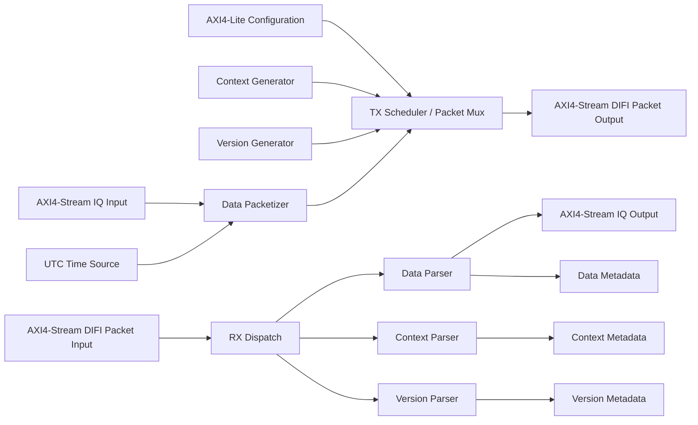

# DIFI 1.1 FPGA Digital IF Protocol Engine：设计与验证报告

> 全国大学生嵌入式芯片与系统设计竞赛（AMD 自主选题赛道）  
> 项目仓库：`https://github.com/tutushiyigeop-oss/difi-engine`  
> 参考源码：`chore/competition-submission-cleanup` 分支；具体提交版本以 Git Tag / 源码归档为准  
> 证据口径：工程实测、开发者反馈及 AI 协作追溯性复盘分别标注来源  
> 文档基准日期：2026-10-23

## 摘要

本项目针对数字中频（Digital IF）场景中的 IQ 数据封装与跨系统互操作需求，设计实现了基于 **VITA 49.2 / DIFI Profile 1.1** 的 FPGA 协议收发引擎。引擎采用 Verilog RTL 实现，提供 AXI4-Stream IQ 输入/输出及协议报文输入/输出，使用 AXI4-Lite 完成配置与状态访问，支持 Signal Data、Standard Flow Signal Context 与 Version Flow Context 三类报文的生成和解析，并提供 Stream ID 过滤、Sequence 检查、时间戳与协议错误事件等功能。

在 XC7Z020CLG400-2 上，项目完成了 RTL 系统级仿真、BRAM 存储结构优化、封装 IP 的真实布局布线、Zynq PS/PL AXI DMA 板级数据回环与完整 DIFI 报文的 UDP 网络发送与接收解析。100 MHz 理想 RTL 回环测试中，100 个数据包 / 25,600 个 IQ 样本均正确，IQ 有效吞吐率为 **196.916 MB/s**。封装 IP 的已布线资源占用为 **1,776 LUT、2,309 FF、1 RAMB18、0 DSP**，Setup WNS **+0.411 ns**。B5 网络验证中，PC 端收到 **1 Version + 1 Context + 20 Data** 共 22 个 DIFI Packet，5,120 个 IQ 样本全部正确；DIFI Consortium 开源参考工具以 DIFI 1.1 模式检查上述 B5 三类报文，结果均为 PASS。新增 B6 网络接收链路中，PC 经 UDP 发送 Version×1、Context×1、Data×20；PL Metadata Monitor 记录 Version/Context 各一次有效握手，Data 经 FPGA RX Parser 恢复 **5,120 IQ** 且全部匹配，Sequence 经历 **15→0** 回绕。

为检验可复现性，项目使用从原始 Vivado 工程导出的 Tcl 快照独立重建**三套硬件工程**，完成综合、实现和 Bitstream/XSA 导出。B6 v0.2 独立重建 Setup WNS 为 **+2.372 ns**，Hold WHS 为 **+0.053 ns**；开发者于 2026-10-23 确认新 XSA 已完成三类 UDP RX 上板回归。三套 Tcl 和实现工具证据已归档；当前 B6 重建报告记录了本机生成路径与实现结果，未归档该次重建 XSA/Bitstream 的 SHA256 或二进制。基于上述 Vivado 实现数据、原始 B6 功能日志和开发者确认的重新上板结果，本阶段工程验证已完成。本文明确区分 RTL 理想吞吐率、Simple DMA 系统吞吐率与真实 UDP 功能验证结果；不将参考工具 PASS 表述为 DIFI Consortium 正式认证。

**关键词：** FPGA；Zynq-7000；DIFI 1.1；VITA 49.2；AXI4-Stream；AXI DMA；UDP；可复现构建

---

## 1. 选题背景、目标与价值

### 1.1 选题背景

数字中频系统需要在信号采集、数字处理及通信传输节点之间传递 IQ 样本及配套元数据。直接发送原始 IQ 字节流难以统一表达样本属性、时间戳、流标识等信息。DIFI Profile 在 VITA 49.2 的基础上规定了特定互操作约束，适合作为可验证的数字中频报文接口。

本项目聚焦**可独立集成的 FPGA 端协议收发组件**及其在 Zynq PS/PL 协同架构下的工程化验证，而非在 FPGA 内实现完整以太网协议栈。协议部分位于 PL；UDP 网络收发示例由 Zynq PS 侧 lwIP 完成。

### 1.2 设计目标与边界

- 实现三类 DIFI 1.1 报文的发送与接收解析，并完成系统级功能测试。
- 对 IQ、元数据和协议报文提供明确定义的 AXI4-Stream 接口，支持 TVALID/TREADY 背压。
- 提供 AXI4-Lite 配置与状态接口，支持 Shadow→Active Commit、时间源和流标识配置。
- 通过资源优化将接收端整包缓存映射到 FPGA Block RAM。
- 在 Zynq-7020 上完成封装 IP 回环测试、B5 PL→PS UDP→PC 发送测试，以及 B6 PC→PS UDP→PL RX 解析与 IQ/Metadata 接收测试。
- 保存第三方协议参考工具验证证据、综合/实现报告和可重建的 Vivado Tcl 脚本。

**边界声明：** 当前报告覆盖上述已经实现和测试的功能范围；不宣称支持 DIFI 1.1 全部可选功能，不声称取得正式认证，不把简单 DMA 轮询性能等同于纯 PL 吞吐上限。

### 1.3 工程特点与拟突出的创新点

1. **模块化协议收发架构：** 三类报文生成器、TX Scheduler、RX Dispatch 与对应 Parser 解耦，便于独立验证及 IP 复用。
2. **面向 FPGA 存储结构的优化：** 接收端完整报文缓存由寄存器式实现转为可推断 Block RAM 的结构，显著改善综合资源占用。
3. **多层验证闭环：** RTL 黄金模型、综合/时序、PS/PL DMA、UDP/PC 和独立 DIFI 参考工具相互补充，避免仅凭单一仿真结论推断系统正确。
4. **可复现的软硬件工程：** 原始 Vivado 工程的 BD Tcl 导出、全新目录恢复、重新生成 XSA 与上板回归形成闭环。

**比较范围：** 上述工程特点能够由本项目 RTL、实现报告和网络校验记录支持；没有对外部商业 IP 或全部 DIFI/VITA 实现开展统一条件的性能基准测试，因此不使用“首创”“唯一”“最先进”等缺乏证据的比较性结论。

## 2. 设计需求与支持范围

| 功能 | 已实现内容 | 验证方式 |
|---|---|---|
| Signal Data Packet | IQ 样本打包、解包、元数据提取 | 模块级及系统级 Testbench；板级 IQ 数据对比；UDP PC 解析 |
| Standard Flow Signal Context | Context 生成及解析 | RTL 测试、B5 UDP 抓包/参考工具、B6 PL Metadata 握手计数 |
| Version Flow Context | Version 生成及解析 | RTL 测试、B5 UDP 抓包/参考工具、B6 PL Metadata 握手计数 |
| TX 调度与 Packet Mux | 三类报文调度、包边界切换 | System Testbench |
| RX 类型分发 | 分类路由、错误类型丢弃 | RX Dispatch Testbench |
| AXI4-Lite 配置 | Shadow/Active Commit、状态读取和流配置 | 仿真及 Vitis 控制配置 |
| 时间戳 | UTC 时间加载与协议字段编码 | RTL、B5 板级测试与参考工具（仅限已覆盖字段） |
| 异常输入 | Stream ID、Size、TKEEP、TLAST 等检查 | 相关 RTL 异常包测试；不等于覆盖全部协议异常 |

实际模块端口与寄存器偏移应结合 `rtl/top/`、`rtl/common/difi_time_cfg_regs.v`、`rtl/include/difi_cfg_regmap.vh`、`rtl/include/difi_time_cfg_regmap.vh` 以及 `docs/interface/` 核对；B5/B6 板级工程是独立配置，不等同于规格描述的统一外围封装。

## 3. 总体架构及软硬件划分

### 3.1 协议引擎数据通路


*图 3-1　DIFI 1.1 协议引擎内部结构：TX 路径包含 Data/Context/Version 生成与调度；RX 路径包含类型分发与三类解析器。图中时间源与周期触发为 B5 包装层的辅助模块，不属于 `difi_engine_top` 内部实例。*



> 此图为功能结构概括图，正式报告中的细节连线以源码及 Vivado BD 为准。

### 3.2 Zynq 硬件测试：三套不能混淆的 BD

**A. 封装 IP 回环工程**：`difi_ip_test` / `difi_ip_test_wrapper`

```text
PS DDR → AXI DMA MM2S → DIFI Engine TX → DIFI Engine RX → AXI DMA S2MM → PS DDR
```

该路径验证 IQ→DIFI Packet→IQ 的逻辑闭环；DMA S2MM 获得的是**解析后的 IQ 数据**。

**B. B5 原始报文导出工程**：`difi_system` / `difi_system_wrapper`

```text
PS DDR → AXI DMA MM2S → DIFI TX → AXI DMA S2MM → PS DDR
                                              ↓
                                    PS lwIP / GEM0 UDP → PC
```

该路径 S2MM 接收的是**完整的 DIFI Packet**，PS 负责将 32 位报文 Word 按网络字节序序列化，并经 UDP 发送到 PC。此工程不是 TX/RX 自回环工程。B4 历史工程与 B5 使用同名 `difi_system`，重建时需根据 BD 内原始 Packet 导出模块识别。

**C. B6 PC→FPGA UDP RX 工程**：`difi_ip_test` / `difi_ip_test_wrapper`（BD 与封装 IP 回环工程同名，但连接关系不同）

```text
PC UDP → PS GEM0/lwIP → DDR → AXI DMA MM2S → DIFI RX Parser
                                               ├→ Data IQ → DMA S2MM → PS Golden 校验
                                               └→ Version/Context Metadata → 监控器 → AXI GPIO → PS
```

使用 `scripts/vivado/generated/b6_udp_rx/bd.tcl` 真实快照；监控 GPIO 基址 `0x41200000`。B6 不包含 B5 UDP TX 原始 Packet 导出通路；与前两套 XSA 和 Vitis 软件不能混用。


*图 3-2　B5 板级系统数据通路。PS 通过 AXI4-Lite 控制 PL 寄存器；DMA 经 HP0 访问片外 DDR。MM2S 提供原始 IQ；S2MM 收回完整 DIFI 报文；PS GEM0/lwIP 再将报文作为 UDP Payload 发往 PC。图示不表示 PL 内存在 UDP 协议栈或 B5 配置了 TX→RX 回环。*

### 3.3 软硬件划分依据

PL 使用状态机及流式接口处理周期敏感的协议字段封装与解析；PS 用于配置寄存器、初始化时间源、控制 AXI DMA、进行缓冲区缓存维护及 UDP 网络通信。这一划分避免将每个数据 Word 的封装过程交给 PS 软件，同时充分利用 Zynq 的外设与应用程序开发能力。

## 4. RTL 设计中的关键机制

### 4.1 AXI4-Stream 传输语义

仅在 `TVALID && TREADY` 时计为一次成功传输；背压期间应维持待发送数据和侧带字段稳定。`TLAST` 表示当前 Packet 的末字；在本项目采用的 32-bit DIFI Word 路径中，完整 Word 使用 `TKEEP=4'b1111`。

### 4.2 配置一致性

TX 配置由 AXI4-Lite Shadow 寄存器写入，经 Commit 完成 Active 配置更新。报文生成模块在报文开始时使用必要的配置和时间快照，避免 Packet 中途出现配置混杂。

### 4.3 RX 缓存、错误控制与 Metadata

Data Parser 对完整接收报文进行检查，在接受正确的完整 Packet 之后提交 Metadata，再输出缓存 IQ 数据。解析器提供长度、字段、Stream ID、TLAST/TKEEP 及序列等检查。针对多个错误同周期出现的情形，项目 Testbench 验证其预设优先级；精确的错误编码、优先级与恢复行为以 `rtl/include/difi_v1_1_defs.vh` 和 RTL/Testbench 为准。

### 4.4 BRAM 推断优化

将 Data Parser 的整包 IQ 存储结构调整为具备同步读特征的存储体，避免大量寄存器实现缓存。这提高资源效率，但也引入整包接收/验证后再输出的延迟与串行处理吞吐约束。

## 5. 优化前后性能与资源比较

### 5.1 OOC 综合对比

条件：`difi_engine_top`，XC7Z020CLG400-2，Vivado 2024.2，OOC Synthesis；**同一统计口径比较**。

| 指标 | 优化前 | 优化后 | 变化 |
|---|---:|---:|---:|
| LUT | 4,023 | 1,516 | −62.32% |
| FF | 10,446 | 2,202 | −78.92% |
| RAMB18 | 0 | 1 | +1（用于缓存推断） |
| DSP | 0 | 0 | 无变化 |

证据：`report/results/ooc/utilization.rpt`、`report/results/ooc_new/utilization.rpt`。上述为综合阶段比较；不要与下节的封装 IP 实现后资源表混用。


*图 5-1　原始综合报告提取的资源对比。LUT 减少约 62.32%、FF 减少约 78.92%；引入 1 块 RAMB18。只比较同一 RTL 顶层的 OOC 综合结果，不能将它与封装 IP 的实现后资源混作一组。*

### 5.2 封装 IP 实现后资源与时序

条件：`difi_ip_test_wrapper`，XC7Z020CLG400-2，100 MHz，Routed。

| 资源 | DIFI 封装 IP | 完整 PL 系统 |
|---|---:|---:|
| LUT | 1,776 | 4,562 |
| FF | 2,309 | 6,000 |
| RAMB36 | 0 | 2 |
| RAMB18 | 1 | 1 |
| DSP | 0 | 0 |

Setup WNS = **+0.411 ns**；TNS = **0 ns**；规定约束满足。此处的封装 IP 包含协议核心、时间源、时间配置与周期触发模块；完整 PL 系统还包含 AXI DMA、互连等外围。

证据：`report/results/packaged_ip_impl/utilization.rpt`、`timing_summary.rpt`、`critical_paths.rpt`、`drc.rpt`。

### 5.3 RTL IQ 有效吞吐率与延迟

在 100 MHz、理想直接 TX→RX 回环、每包 256 个 32-bit IQ、外部无背压条件下：

| 指标 | 测试结果 |
|---|---:|
| 数据包数 | 100 |
| IQ 样本总数 | 25,600 |
| IQ Payload 字节数 | 102,400 B |
| 测量时钟周期数 | 52,002 cycles |
| IQ 有效吞吐率 | **196.916 MB/s** |
| 首 IQ 延迟（min/avg/max） | **266 / 516.470 / 519 cycles** |
| IQ 数据错误事件 | 0（测试覆盖范围内） |

计算方式：`102400 B / (52002 / 100 MHz) = 196.916 MB/s`。理论 32-bit × 100 MHz 物理通路带宽 400 MB/s，这与 DIFI Header、接收整包缓存、输出阶段分离下的有效 IQ 速率不同。该结果不等同于 DMA、UDP 或 PHY 的线速吞吐。

证据：`report/results/perf/difi_perf_latency.csv`、`sim/perf/tb_difi_engine_perf.v`。


*图 5-2　逐包延迟来自原始 `difi_perf_latency.csv`：首包为 266 cycles，其余 99 包均为 519 cycles；100 包平均 516.470 cycles。数值是理想 RTL 回环条件下的首 IQ 延迟，不是网络传输时延。*

### 5.4 板级 DMA 回环

在 Zynq-7020 上，封装 IP 回环使用 100 包 × 256 IQ 的数据集，共 **25,600 IQ 全部正确、失配为 0**。计时数据来自 Cortex-A9 PMU 周期计数器，PS CPU 配置频率在后续核对中确认为**666.666666 MHz**（显示时约 666.667 MHz）。据已归档的 `2,729,306` 完整窗口 ticks 和 `636,916` 次 DMA 事务窗口总 ticks 换算，分别约 **25.01 MB/s** 与 **107.18 MB/s**。报告应继续保留原始 ticks 和换算公式：

- `system_MBps = 102400 × 666666666 / (2729306 × 10^6)`
- `dma_window_MBps = 102400 × 666666666 / (636916 × 10^6)`

**口径说明：** 该系统级结果包含 Simple DMA 逐包重新启动、PS 轮询及 DDR/软件开销，不能用于宣称 PL 协议引擎最大处理性能。现已将 `report/results/perf/performance_summary.md` 的换算口径与本报告同步；最终仍须为开发者确认的约 666.667 MHz CPU 时钟补档与该次 XSA 相对应的原始配置证据。


*图 5-3　RTL 理想回环 196.916 MB/s；板级 DMA 事务窗口约 107.18 MB/s；完整 PS 软件测试窗口约 25.01 MB/s。板级换算以开发者确认的 PS CPU 666.666666 MHz 配置及 PMU 每周期递增 1 为前提，仍需归档同次 XSA 的 PS 时钟配置对应关系（频率本身已确认）。三组数据并非同一环境下的端到端性能比较，不能根据横条差额推出协议引擎的 PL 吞吐退化。*

## 6. Zynq UDP 端到端验证与第三方检查

### 6.1 B5 测试条件

- 硬件：Zynq-7020，PS GEM0 网络接口；B5 原始报文导出工程。
- 发送端 IP：`192.168.1.10`；PC 测试网卡 IP：`192.168.1.20`；UDP 端口：`4991`。
- START 控制：PC 发送启动请求，Zynq 接收后按已配置测试序列发包。
- 数据：1 个 Version（44 B）、1 个 Context（108 B）、20 个 Data（每个 1052 B）。

### 6.2 应用层校验

PC 接收脚本 `scripts/verify/tools/difi_udp_receiver.py` 对类型、长度、Stream ID、序列字段及 IQ 样本进行检查，得到：

- **22/22 Packet 正确接收**；总 UDP Payload **21,192 B**。
- **20 × 256 = 5,120 IQ** 全部匹配；Sequence 计数按 4 bit 回绕。
- 程序人为设置 2 ms 的报文间隔，**本轮不是 UDP 最高吞吐测试**。

证据：`report/results/udp/tx/validation_notes.md`、完整 `.pcapng`、PC 侧日志和截图。

### 6.3 B6 PC UDP→PL RX 板级验收（2026-10-23）

B6 与 B5 为**独立 XSA/Bitstream**：B6 从 PC (`192.168.1.20`) 接收 UDP Payload，Zynq PS GEM0/lwIP 将完整 32-bit 网络大端报文转换并写入 DDR，AXI DMA MM2S 发送至 PL `S_AXIS_RX_PKT`。Data Parser 输出 256 个 I16/Q16 样本，经 DMA S2MM 返回 PS 与 Golden 比对；Version 和 Context 没有 IQ 输出，使用接在同一 PL 时钟域的 [Metadata Monitor](../../rtl/board/difi_b6_rx_meta_monitor.v) 统计各自 `VALID && READY` 握手，状态经双通道 AXI GPIO (`0x41200000`) 提供给 PS。

正式三类接收程序为 [`difi_b6_udp_rx_pro/src/main.c`](../../vitis/vitis_ws/difi_b6_udp_rx_pro/src/main.c)，PC 端使用 [`difi_b6_three_types.py`](../../scripts/verify/tools/difi_b6_three_types.py)。

| B6 类型 | 本轮网络输入 | FPGA 验证依据 | 结果 |
|---|---:|---|---|
| Version | 1 × 44 B | Metadata 有效握手计数 +1；Sequence/Changed/错误事件检查 | PASS |
| Context | 1 × 108 B | Metadata 有效握手计数 +1；Sequence/Changed/错误事件检查 | PASS |
| Data | 20 × 1,052 B | DMA 恢复 20 × 256 = 5,120 IQ，PS Golden 对比；Sequence 15→0 | PASS |

原始依据：[`report/results/udp/rx/three_types_udp_rx.rtf`](../results/udp/rx/three_types_udp_rx.rtf)。**验证边界：** 未经 PS 逐字段回读核验 Version/Context 所有 Metadata；不声称 B6 已经获得 DIFI Consortium 第三方认证、并发全双工或无 ACK 连续传输性能。B6 已提交软件、RTL、真实 BD Tcl、原始与独立重建的实现报告；新 XSA 三类 UDP RX 板级回归由开发者确认成功，B6 本阶段验收已收束。见 `scripts/vivado/generated/b6_udp_rx/` 工程快照。

### 6.4 DIFI Consortium 开源参考工具校验（仅 B5 TX 真实 PCAP）

使用 DIFI Consortium 的 `certify_source.py --difi-version 1.1`。由于测试中 Version 与 Context/Data 使用不同 Stream ID，为避免参考工具的跨流统计产生歧义，保存原始完整 PCAP 并分别导出两组流进行离线检查。

| 流 | 符合项 | 不符合项 | 结果 |
|---|---:|---:|---|
| Version | 1 | 0 | PASS |
| Context | 1 | 0 | PASS |
| Data | 20 | 0 | PASS |

**边界：** 此结果表示第三方开源参考程序在本轮检查范围内 PASS，**不等于 DIFI Consortium 的正式认证**。证据保存在 `report/results/udp/tx/consortium/`；该参考工具检查对象是 B5 TX 抓包，并非 B6 RX 链路。


*图 6-1　三条测试链路的黄金数据比对规模：RTL 回环 25,600 IQ、板级 DMA 回环 25,600 IQ、B5 UDP 到 PC 5,120 IQ，已记录样本均无失配。图中没有展示新增 B6 的 5,120 IQ 恢复和 Version/Context Metadata 事件，它们另有串口证据；第三方参考工具检查的 PASS 也不是正式认证。*

### 6.5 PC 端可视化 Dashboard 实机集成（2026-10-23）

项目新增 `dashboard/` 中的 **DIFI ENGINE CONTROL CENTER**，使用 PySide6 / pyqtgraph，通过非阻塞 QProcess 对接既有 B5 UDP 接收验证和 B6 UDP 发送/ACK 校验程序，提供链路动画、三类 Packet 统计、Sequence 时间轴、IQ 波形、日志及会话结果导出。Re​​play/Offline 仅用于标注的离线演示样例。

开发者于 2026-10-23 确认：**B5 UDP TX 与 B6 UDP RX 两种 Dashboard Live / Hardware 模式均已在实体开发板上运行成功，界面正常工作**。Dashboard 可通过 `dashboard/tests/` 中的自动化测试检查，B5/B6 实机运行仍须使用对应的硬件配置。

界面未改变 B5/B6 固定实验的 FPGA 硬件边界：B5 波形来自 PC 实收并验证的 Packet；B6 波形是发包脚本 Golden Reference，板卡 ACK 仅确认内部 IQ/Metadata 验证结果。B5/B6 需要切换各自 XSA 与 Vitis 程序，**不是**单套 XSA 同时全双工运行，也不是 GUI 任意自定义 Packet 生成/实时返回能力。

## 7. Tcl 构建可复现性验证

使用 `scripts/vivado/export_bd.tcl`、`rebuild_bd.tcl` 和 `verify_rebuilt_impl.tcl`，分别对封装 IP (`packaged_ip`)、B5 原始 Packet (`b5_raw_export`) 和 B6 UDP RX (`b6_udp_rx`) 执行：原始工程导出 BD Tcl → 独立目录重建 → Vivado 综合实现 → Bitstream/XSA → Vitis 使用新平台再上板。

| 验证项 | 封装 IP 工程 | B5 UDP 工程 | B6 UDP RX 工程 |
|---|---:|---:|---:|
| 目标 Part | xc7z020clg400-2 | xc7z020clg400-2 | xc7z020clg400-2 |
| 顶层 | `difi_ip_test_wrapper` | `difi_system_wrapper` | `difi_ip_test_wrapper` |
| 综合/实现/Bitstream | PASS | PASS | PASS |
| Setup WNS | +0.411 ns | +2.206 ns | +2.372 ns |
| Hold WHS | +0.046 ns | +0.021 ns | +0.053 ns |
| 重建 XSA | 已生成 | 已生成 | 已生成 |
| 新重建工程上板回归 | 开发者确认通过 | 开发者确认通过 | 开发者于 2026-10-23 确认三类 UDP RX PASS |

证据：`report/results/vivado_rebuild/{packaged_ip,b5_raw_export,b6_udp_rx}/SUCCESS.txt` 及各自实现报告。**证据边界：** B6 `SUCCESS.txt` 在板级回归前生成，内部“未上板”属于原始工具状态，不作篡改；开发者随后反馈 B6 重建版本已重新上板通过；重建实现报告本身是工具输出，并不包含新的板级串口测试日志或 XSA/Bitstream 哈希。原始工具日志和早期 UART 文件保留各自真实的测试时间线。

## 8. 大模型协作与技术纠错

开发过程的五个代表性案例收录于[《AI 协作与技术纠错工程复盘》](ai_collaboration_report.md)。其中 R01～R04 来自两份用户导出的 ChatGPT 原始会话 PDF，现有可检索文本和逐页索引；C01～C05 仍基于历史讨论、Git 修改和工具输出编制，属于**追溯性技术复盘而非逐字聊天转录**。原始 PDF 已归档，文件完整性经比对；详见[对话索引](../ai_collaboration/transcripts/README.md)。每案按实际问题、技术建议、开发者选择、实现/测试和可复用方法组织。

| 案例 | 人机协作的主要对象 | 工程结果 |
|---|---|---|
| C01 Data Parser | 握手条件、Word0/RECV 错误优先级、DROP 恢复 | RTL 的接收状态机及异常 Packet Testbench |
| C02 BRAM 优化 | 异步数组读取的资源热点、同步读/预取 | OOC LUT 4023→1516，FF 10446→2202，RAMB18 0→1 |
| C03 Icarus | 先后识别缺失 include 路径与模块源码编译输入 | 纠正编译依赖，恢复本地仿真流程 |
| C04 Vivado Tcl | 检测误报与 BD 导出、重建、实现分层 | 三套 BD 重新实现并生成 Bitstream/XSA |
| C05 UDP 参考检查 | 完整 DIFI 抓包、不同 SID 的参考工具输入处理 | 22 包和 5,120 IQ 校验，开源工具分流检查 PASS |

[证据索引](../ai_collaboration/evidence_index.csv)将案例与源码、历史提交、Vivado 报告、PCAP 和测试结果一一对应。原始工具输出、开发者回顾与技术分析按其证据属性解释，不能将工程结果倒推成 AI 原话。

## 9. Skill 技能包与复用方法

仓库 `skill/` 保留四项工程 Skill，具体使用步骤以各自 `SKILL.md` 为准：

| Skill | 主要用途 | 对应项目实践 |
|---|---|---|
| `vivado-rebuild` | BD 导出、依赖核查、全新工程重建及分层结果检查 | C04、三套 Vivado BD |
| `zynq-dma-debug` | Simple DMA、Cache、AXIS Packet 边界与错误定位 | 板级 DMA 回环、B5/B6 应用 |
| `axis-rtl-verification` | TVALID/TREADY、背压、Golden Model、异常包测试 | C01/C02/C03、Parser/Packetizer Testbench |
| `udp-packet-validation` | UDP Payload、PCAP、序列与 IQ 比对、DIFI 参考检查 | C05、B5 UDP 验证 |

每项 Skill 的前提、脚本命令、失效条件均在对应文件中说明。Skill 内容作为实际开发经验的可复用表达，DIFI 原工程的实测结果不能自动代表任意外部项目都得到相同结果。

## 10. 复现说明与交付物

### 10.1 环境

- AMD/Xilinx Zynq-7020（`xc7z020clg400-2`）；Vivado / Vitis **2024.2**。
- Python、Icarus Verilog、Wireshark（按具体测试准备）；DIFI Consortium 参考工具为独立第三方组件。
- 软件与 IP 依赖以根目录 `README.md`、`scripts/vivado/`、`ip_repo/`、`vitis/` 为准。

**版本差异说明：** AMD 指南推荐 2025.2 或 2026.1；本工程实际采用 2024.2，因此需保留版本信息和 Tcl 可复现证据。

### 10.2 推荐复现顺序

1. 检出最终提交时冻结的 Git SHA / Tag，确认 RTL、IP Repo、构建脚本和 XDC 完整。
2. 运行 RTL 模块与系统级仿真；执行性能 Testbench 并检查 100 包黄金 IQ。
3. 使用 `scripts/vivado/` 导入三套真实 BD 快照，在新的工程目录中重建并重新综合/实现。
4. 根据对应的 XSA 重新创建 Vitis Platform/BSP 和应用（需要在根 README/附录给出逐项设置）；下载匹配的新 Bitstream。
5. 在封装 IP 工程复现板级 100 包 DMA IQ 回环。
6. 在 B5 工程复现 UDP 22 包发送、PC IQ 比对及 Wireshark 抓包。
7. 在 B6 独立重建 XSA 上执行 PC→FPGA 三类 UDP RX 回归：Version/Context Metadata 握手与 20×256 IQ Golden 对比。
8. 对 B5 抓包按 DIFI 1.1 模式分别验证 Version 与 Context/Data 流，并归档脚本版本、PCAP Hash、输出日志。

### 10.3 交付文件

工程交付包含 Verilog RTL 与 Testbench、Vivado IP 封装与 Block Design 重建 Tcl、Zynq Vitis 应用、B5/B6 UDP 收发及校验工具、Dashboard 和自动测试。报告所引用的资源时序结果、板级串口记录、PCAP 与 DIFI 开源参考检查结果保存在 `report/results/`，可复用工程工具见 `skill/`。

报告引用的指标必须按照原始测试条件解释，不能将 RTL 理想仿真吞吐率、板级 DMA 事务吞吐率与实际 UDP 网络吞吐率视为同一口径。

---

## 附录 A：主要证据路径索引

| 证据类型 | 仓库路径 |
|---|---|
| OOC 优化前 | `report/results/ooc/utilization.rpt` |
| OOC 优化后 | `report/results/ooc_new/utilization.rpt` |
| 封装 IP 已布线资源及时序 | `report/results/packaged_ip_impl/` |
| 性能 CSV / 板级 PMU 原始值 | `report/results/perf/` |
| B5 实现结果 | `report/results/b5_impl/` |
| 原始 PCAP、截图、第三方日志 | `report/results/udp/` |
| Tcl 独立重建验收 | `report/results/vivado_rebuild/` |
| 可复现 BD Tcl 脚本 | `scripts/vivado/` |
| Vivado 封装 IP | `ip_repo/difi_engine_ip/` |
| Vitis C 源码 | `vitis/vitis_ws/` |
| Skill | `skill/` |

## 附录 B：结果解释与适用范围

1. DIFI 标准符合性声明不可超出已测试内容，不可将开源工具 PASS 说成“官方认证”。
2. 196.916 MB/s 只能称为无外部背压 RTL 理想回环的 **IQ 有效吞吐率**。
3. 25.01/107.18 MB/s 必须保留 CPU 时钟配置与 PMU ticks 的计算口径；不同条件不能横比。
4. OOC 资源对比、封装 IP 资源与完整 PL 资源是三种不同统计口径。
5. “新 XSA 上板通过”依据开发者实际复测确认；原始 Vivado 工具 PASS 与先前 B6 UART 验证材料均保留其真实时间线，本阶段不再设置附加归档要求。
